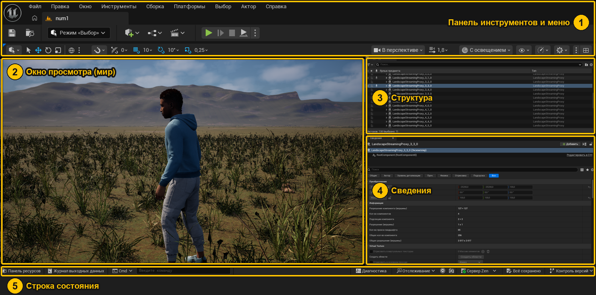

# Начни отсюда

> **Методичка по Unreal Engine 5.8 на примере твоего проекта prog2.** Как сделаны земля, трава, свет, тени, персонаж — и как это повторить или поменять самому.
>
> **Окружение:** Unreal Engine 5.8, проект `prog2` (шаблон Open World), уровень `num1`.
> Всё описанное здесь реально сделано в этом проекте — можно открыть и потрогать.

## С чего начать

| Ты сейчас… | Открой |
|---|---|
| **не понимаешь, что где на экране** | [**Интерфейс по картинкам**](ref/01-interfeys.md) — скриншоты с номерами: каждая кнопка подписана |
| **впервые открыл Unreal** и не знаешь, куда нажать | [**Первый час в Unreal**](02-pervyj-chas.md) — по шагам: полетать, поставить куб, сыграть |
| хочешь **учиться на практике** — строить и по ходу разбираться | [**🏠 Строим дом**](igry/00-dom-o-kurse.md) — 9 этапов: от кубиков до игры в .exe |
| хочешь **разобраться по порядку** | [**Маршрут изучения**](00-marshrut.md) — 8 этапов: что осваивать, какой квест сделать, когда идти дальше |
| встретил **непонятное слово** | [**Словарь терминов**](10-slovar.md) |
| ищешь, **какую кнопку нажать** | [Шпаргалка](01-shpargalka.md) · [Карта меню с картинками](ref/07-menyu.md) |
| что-то **сломалось** | [Частые вопросы](06-faq.md) |

### Так выглядит редактор



**1** — меню и кнопки (▶ — играть) · **2** — сам мир · **3** — список всего на уровне · **4** — настройки выделенного · **5** — склад файлов, журнал ошибок, «Всё сохранено». Подробно про каждую область — [Интерфейс редактора](ref/01-interfeys.md).

> 💡 **Как здесь учиться.** Каждая глава «Как сделан проект» — это разбор одной части мира `prog2` и **квесты**: ты повторяешь то же самое руками на своём учебном уровне. В конце главы — вопросы, карточки и **босс** — задание посложнее, уже без пошаговых подсказок. Читать без квестов почти бесполезно: Unreal учат руками.

---

## Что где лежит

```
prog2/
│
├── docs/                  ← ты здесь: эта методичка
│   ├── 00-НАЧНИ-ОТСЮДА.md   карта и ссылки на всё
│   ├── 01-shpargalka.md     горячие клавиши и частые действия на один экран
│   ├── 06-faq.md            частые вопросы и «почему у меня не так»
│   ├── img/                 скриншоты редактора с номерами (исходники — img/_raw)
│   ├── ref/                 СПРАВОЧНИК: основы Unreal по темам
│   ├── proekt/              КАК СДЕЛАН ПРОЕКТ: 9 глав с квестами
│   └── igry/                СТРОИМ ДОМ: практический курс, 9 этапов
│
├── Content/               всё, что видно в Каталоге ресурсов (ассеты движка)
│   ├── Terrain/             материал земли M_Terrain, MI_Terrain, текстуры
│   ├── Foliage/             трава, камни, M_Foliage, типы травы LGT_*
│   ├── MetaHumans/          персонаж Emanuel (+ BP_EmanuelPlayer — за него играешь)
│   ├── Characters/          манекен и анимации из шаблона Third Person
│   ├── Input/               управление: действия IA_* и раскладка IMC_Default
│   ├── ThirdPerson/         персонаж и режим игры из шаблона
│   └── num1.umap            твой уровень
│
├── SourceArt/             исходники: скачанные текстуры и 3D-модели (не ассеты!)
├── Scripts/               Python-скрипты, которыми всё собрано
└── Config/                настройки проекта (.ini)
```

> **Content и SourceArt — не одно и то же.** В `SourceArt` лежат обычные файлы (`.jpg`, `.png`, `.gltf`), их понимает любой редактор картинок. В `Content` — ассеты Unreal (`.uasset`): то, во что движок превратил исходники при импорте. Игра использует только `Content`.

---

## Как сделан проект — по главам

| # | Глава | О чём |
|---|---|---|
| 1 | [Обзор проекта](proekt/01-obzor.md) | что было в начале, что сделано, общая схема |
| 2 | [Текстуры и импорт](proekt/02-teksturi-i-import.md) | PBR-карты, sRGB, нормали OpenGL/DirectX, сжатие |
| 3 | [Материал земли](proekt/03-material-zemli.md) | 7 слоёв без кисти: шум, склоны, высоты, вариация |
| 4 | [Трава и камни](proekt/04-trava-i-kamni.md) | Landscape Grass, плотность, Nanite, почему упала видеокарта |
| 5 | [Материал листвы и ветер](proekt/05-material-listvy-i-veter.md) | просвечивающие листья, маска, ветер своими руками |
| 6 | [Свет и тени](proekt/06-svet-i-teni.md) | солнце, небо, Lumen, виртуальные тени — откуда что |
| 7 | [Персонаж](proekt/07-personazh.md) | MetaHuman + шаблон Third Person: бег, шаг, прыжок |
| 8 | [Площадка под дом](proekt/08-ploshchadka-pod-dom.md) | круг без травы и как строить дом самому |
| 9 | [Python и автоматизация](proekt/09-python-i-avtomatizaciya.md) | как я управлял редактором скриптами — и как можешь ты |

## Справочник по темам

| Тема | Что внутри |
|---|---|
| [Интерфейс редактора](ref/01-interfeys.md) | **по скриншотам**: каждая область экрана и кнопка с номером |
| [Акторы, компоненты, уровни](ref/02-aktory-i-komponenty.md) | из чего состоит мир, World Partition |
| [Материалы](ref/03-materialy.md) | **по скриншотам**: редактор материалов, выходы, ноды, параметры, инстансы |
| [Блюпринты](ref/04-blueprinty.md) | **по скриншотам**: окно редактора, ноды, провода, переменные, компиляция, разбор готового графа |
| [Ландшафт](ref/05-landshaft.md) | **по скриншотам**: режим «Ландшафт», все инструменты кисти, слои, связь с материалом |
| [Производительность](ref/06-proizvoditelnost.md) | **по скриншотам**: stat unit / stat gpu на твоём уровне, «Сложность шейдера», Nanite, качество |
| [Карта меню](ref/07-menyu.md) | скриншот каждого меню, нужные пункты обведены и объяснены |

---

## Куда идти прямо сейчас

### 🔴 Что-то не работает

| Ситуация | Куда |
|---|---|
| Трава/объект стал серым | [FAQ: серый материал](06-faq.md#объект-или-трава-стали-серыми) |
| «Произошёл программный сбой ГП» | [FAQ: сбой видеокарты](06-faq.md#сбой-видеокарты-device-removed) |
| Не появляется трава | [FAQ: нет травы](06-faq.md#трава-не-появляется) |
| Персонаж не бегает / не тот персонаж | [FAQ: персонаж](06-faq.md#при-play-появляется-не-emanuel) |

### 🟡 Хочу поменять

| Что | Где |
|---|---|
| Больше/меньше грязи, леса, скал | `Content/Terrain/MI_Terrain` → [параметры](proekt/03-material-zemli.md#ползунки-mi_terrain) |
| Густоту травы | `Content/Foliage/LGT_*` → [глава 4](proekt/04-trava-i-kamni.md#как-поменять-густоту) |
| Силу ветра | `M_Foliage` / инстансы `MI_grass_*` → [глава 5](proekt/05-material-listvy-i-veter.md#ползунки-ветра) |
| Время суток | `DirectionalLight` → [глава 6](proekt/06-svet-i-teni.md#как-поменять-время-суток) |
| Место площадки под дом | `MI_Terrain` → группа House → [глава 8](proekt/08-ploshchadka-pod-dom.md) |

### 🟢 Управление в игре (кнопка ▶ Play)

| Клавиша | Действие |
|---|---|
| `W A S D` | бег |
| `Shift` + `W A S D` | шаг |
| `Пробел` | прыжок |
| мышь | поворот камеры |
| `Esc` | выйти из игры обратно в редактор |
| `Shift+F1` | отпустить мышь, не выходя из игры |
