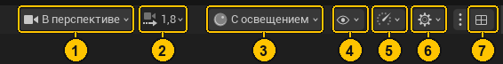

# Шпаргалка

> Горячие клавиши и частые действия Unreal Editor на один экран — без объяснений, только «что нажать».

Названия пунктов меню даны так, как они выглядят в русском интерфейсе, в скобках — английский оригинал (по нему проще гуглить).

> 📖 **ЛКМ / ПКМ / СКМ** — левая, правая и средняя (колесо) кнопки мыши. Клавиши даны по умолчанию; если ты их менял в **Правка → Сочетания клавиш**, могут не совпасть.

> 💡 Не знаешь, где на экране нужная кнопка? Смотри [Интерфейс по картинкам](ref/01-interfeys.md) и [Карту меню](ref/07-menyu.md) — там скриншоты с номерами.

---

## Вьюпорт: как двигаться

| Действие | Клавиши |
|---|---|
| Лететь как в игре | зажать **ПКМ** + `W A S D`, `Q`/`E` — вниз/вверх (или стрелки, `PageUp`/`PageDown`) |
| Скорость полёта | колесо мыши, пока зажата ПКМ |
| Осмотреться | зажать **ПКМ** и двигать мышь |
| Ехать вперёд-назад с поворотом | зажать **ЛКМ** и двигать мышь |
| Сдвинуть вид без поворота | зажать **СКМ** (колесо) или **ЛКМ + ПКМ** и двигать |
| Шаг вперёд/назад | крутить колесо |
| Приблизить к выбранному | `F` (Focus) |
| Облететь вокруг объекта | `Alt` + **ЛКМ** |
| Приблизиться к объекту | `Alt` + **ПКМ** |
| Сдвинуть вид вокруг объекта | `Alt` + **СКМ** |
| Угол обзора шире / уже | **ПКМ** + `Z` / `C` |
| Вид сверху / спереди / сбоку | `Alt+J` / `Alt+H` / `Alt+K`; обратно в перспективу — `Alt+G` |
| Полноэкранный вьюпорт | `F11` |
| Скрыть значки и сетку (игровой вид) | `G` |
| Остановить «живую» картинку (если тормозит) | `Ctrl+R` |

## Объекты

| Действие | Клавиши |
|---|---|
| Выбор / двигать / вращать / масштабировать | `Q` / `W` / `E` / `R`, или `Пробел` — по кругу |
| Добавить к выделению | `Ctrl` или `Shift` + клик |
| Привязка к сетке | кнопки сетки **слева** вверху вьюпорта (включены сразу) |
| Прилепить к вершине другого объекта | держать `V` и тянуть стрелку |
| Двигать по двум осям | тянуть за квадратик между стрелками |
| Опустить на землю | `End` |
| Дублировать | `Alt` + тянуть стрелку, или `Ctrl+D` |
| Удалить | `Delete` |
| Спрятать / показать | `H` / `Ctrl+H` |
| Найти выбранный ассет в Каталоге ресурсов | `Ctrl+B` |
| Отменить / вернуть | `Ctrl+Z` / `Ctrl+Y` |

## Игра в редакторе

| Действие | Клавиши |
|---|---|
| Запустить (Play) | `Alt+P` или зелёный ▶ |
| Управлять персонажем | кликни в мир, если мышь «не цепляется» (вверху мелькнёт «Click for Mouse Control») |
| Выйти из игры | `Esc` |
| Отпустить мышь, не выходя | `Shift+F1` |
| Пауза / один кадр вперёд | кнопки ⏸ и ⏭ на верхней панели |
| Летать камерой во время игры | `F8` (Eject — «выпрыгнуть»); обратно в персонажа — кнопка Possess («вселиться») |
| Оставить изменения, сделанные во время игры | выпрыгни (`F8`), выдели объект → `K` или ПКМ → Keep Simulation Changes. Иначе всё откатится после `Esc` |
| Консоль во время игры | `` ` `` (тильда): `stat fps`, `stat unit` |
| Симуляция без игрока | `Alt+S` — мир «живёт» (физика падает), но персонажа нет и камера твоя |
| Где запускать | ⋮ рядом с ▶: **в выбранном окне просмотра** (по умолчанию), **в новом окне редактора**, **автономная игра** (отдельно от редактора, ближе всего к настоящей сборке) |

> 💡 **Подбираешь значения прямо в игре.** Запусти ▶, нажми `F8`, выдели лампу и крути яркость в Сведениях — видно сразу. Понравилось — `K`, и значение сохранится после выхода.

## Файлы и окна

| Действие | Где |
|---|---|
| Сохранить всё | `Ctrl+Shift+S` |
| Открыть ассет по имени | `Ctrl+P` |
| Панель ресурсов (выезжающий Каталог ресурсов) | `Ctrl+Space` или кнопка слева внизу |
| Консоль команд | `` ` `` (тильда) во вьюпорте |
| Журнал (лог) | **Окно → Журнал выходных данных** (Window → Output Log) |
| Настройки проекта | **Правка → Project Settings…** `Ctrl+Alt+P` (Edit → Project Settings) |
| Настройки редактора | **Правка → Настройки редактора…** `Ctrl+Alt+E` (Edit → Editor Preferences) |
| Горячие клавиши | **Правка → Сочетания клавиш…** `Ctrl+Alt+K` |
| Плагины | **Правка → Плагины** (Edit → Plugins) |
| Запустить Python-скрипт | **Инструменты → Выполнить сценарий Python…** (Tools → Execute Python Script) |

## Полезные консольные команды

Нажми `` ` `` во вьюпорте и введи:

| Команда | Что делает |
|---|---|
| `stat fps` | счётчик кадров в секунду |
| `stat unit` | сколько мс уходит на игру / рендер / видеокарту |
| `stat gpu` | на что именно тратит время видеокарта |
| `grass.Enable 0` / `1` | выключить / включить ландшафтную траву |
| `grass.DensityScale 0.5` | временно сделать траву в 2 раза реже |
| `r.ScreenPercentage 70` | рендерить в 70% разрешения (быстрее) |
| `ShowFlag.Grass 0` | спрятать траву только из вида |

## Режимы вьюпорта

Кнопка **«С освещением»** справа вверху вьюпорта (номер 3):

| Режим | Зачем |
|---|---|
| С освещением (`Alt+4`) | обычный вид |
| Без освещения (`Alt+3`) | чистые цвета текстур — видно, правильный ли цвет |
| Только каркасное представление (`Alt+2`) | сетка полигонов |
| Детальное освещение (`Alt+5`) / Только освещение (`Alt+6`) | свет без текстур — видно, откуда тени |
| Визуализация буферов → Base Color | «голый» цвет — так я ловил серую траву |
| Визуализация Nanite → Overview / Triangles | что рисуется через Nanite |
| Виртуальная карта теней | как устроены тени ([глава 6](proekt/06-svet-i-teni.md)) |
| Окрашивание уровней детализации | какие LOD видны |
