# Карта меню редактора

> Что лежит в каждом меню Unreal Editor 5.8 (русский интерфейс) — по скриншотам твоего редактора. Жёлтой рамкой с номером обведено то, что пригодится новичку; всё остальное можно пока не трогать.

← [Производительность](06-proizvoditelnost.md) · [Начни отсюда](../00-НАЧНИ-ОТСЮДА.md)

---

## Как пользоваться этой страницей

Пунктов в меню сотни, а в работе нужен десяток. Поэтому на каждой картинке **жёлтым обведены только нужные пункты**, а под картинкой — таблица: номер → что это и когда нажимать.

> 💡 **Не ищи глазами.** В каждом меню сверху есть строка **«Введите текст, чтобы начать поиск»**. Открыл меню, набрал `python` или `структ` — и нужный пункт остался один.

**Где какое меню:**

| Меню | Где находится | Главное в нём |
|---|---|---|
| [Файл](#файл) | верхнее меню | открыть и сохранить уровень |
| [Правка](#правка) | верхнее меню | отмена, настройки редактора и проекта |
| [Окно](#окно) | верхнее меню | вернуть закрытые окна |
| [Инструменты](#инструменты) | верхнее меню | запуск Python-скриптов |
| [Сборка](#сборка) | верхнее меню | навигация для ИИ, проверка уровня |
| [Платформы](#платформы) | верхнее меню | собрать игру в `.exe` |
| [Выбор](#выбор) | верхнее меню | выделить все объекты одного типа |
| [Актор](#актор) | верхнее меню | действия с выделенным объектом |
| [Справка](#справка) | верхнее меню | официальная документация |
| [Кубик с плюсом](#кнопка-кубик-с-плюсом-быстрое-добавление) | панель, кнопка ⑥ | поставить объект на уровень |
| [Blueprint](#кнопка-blueprint-рядом-с-кубиком) | панель, кнопка ⑦ | блюпринты и игровой режим |
| [Правый клик по объекту](#правый-клик-по-объекту-во-вьюпорте) | в мире | быстрые действия с объектом |
| [С освещением](#кнопка-с-освещением-режим-просмотра) | над миром справа | режим картинки |
| [Глаз](#кнопка-глаз-показать) | над миром справа | что показывать |
| [Шестерёнка](#кнопка-шестерёнка-настройки-вьюпорта) | над миром справа | мышь и скорость |

Где эти кнопки на экране — см. [Интерфейс редактора](01-interfeys.md#верхняя-панель-меню-и-кнопки).

## Файл

Открыть, сохранить, создать — уровни и проекты.

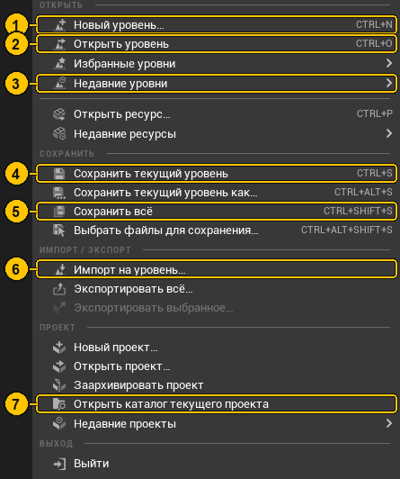

| № | Пункт | Клавиши | Что это и когда нужно |
|---|---|---|---|
| 1 | **Новый уровень…** | `Ctrl+N` | создать пустой уровень — **песочницу для экспериментов**, чтобы не портить `num1` |
| 2 | **Открыть уровень** | `Ctrl+O` | открыть другой уровень (например, вернуться в `num1`) |
| 3 | **Недавние уровни** | | быстрый список последних открытых |
| 4 | **Сохранить текущий уровень** | `Ctrl+S` | сохранить только уровень (расстановку объектов) |
| 5 | **Сохранить всё** | `Ctrl+Shift+S` | **сохранить вообще всё**: уровень, материалы, блюпринты. Жми его по привычке |
| 6 | **Импорт на уровень…** | | принести целую сцену из файла (`.fbx`, `.gltf`) и сразу поставить на уровень |
| 7 | **Открыть каталог текущего проекта** | | открыть папку `prog2` в Проводнике Windows |

> 📖 **Уровень и проект — не одно и то же.** **Проект** (`prog2`) — это вся папка: все файлы, настройки, скрипты. **Уровень** (`num1`) — одна «карта» внутри проекта, как глава в книге. В проекте может быть много уровней.

## Правка

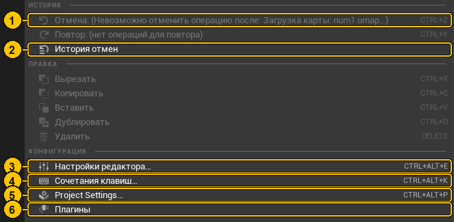

| № | Пункт | Клавиши | Что это и когда нужно |
|---|---|---|---|
| 1 | **Отмена** | `Ctrl+Z` | отменить последнее действие. Рядом **Повтор** `Ctrl+Y` — вернуть отменённое |
| 2 | **История отмен** | | список всех последних действий: можно откатиться сразу на 10 шагов назад |
| 3 | **Настройки редактора…** | `Ctrl+Alt+E` | как ведёт себя **сам редактор** у тебя: язык, автосохранение, скорость камеры |
| 4 | **Сочетания клавиш…** | `Ctrl+Alt+K` | посмотреть и поменять горячие клавиши |
| 5 | **Project Settings…** | `Ctrl+Alt+P` | настройки **игры**: какой уровень открывать первым, управление, графика, упаковка |
| 6 | **Плагины** | | включить/выключить дополнения движка (нужен перезапуск) |

> 💡 **Почему на скриншоте всё серое?** Пункты Отмена, Вырезать, Копировать, Удалить неактивны, когда **нечего** отменять или **ничего не выделено**. Выдели объект — и они оживут. Копировать/вставить/дублировать: `Ctrl+C` / `Ctrl+V` / `Ctrl+D`.

> 📖 **Настройки редактора или Project Settings?** Просто запомнить: **Настройки редактора** — «как мне удобно работать» (хранятся только у тебя). **Project Settings** — «какой будет игра» (хранятся в папке `Config` проекта и попадают в сборку).

## Окно

Все панели редактора. **Закрыл окно случайно — открывай отсюда.**

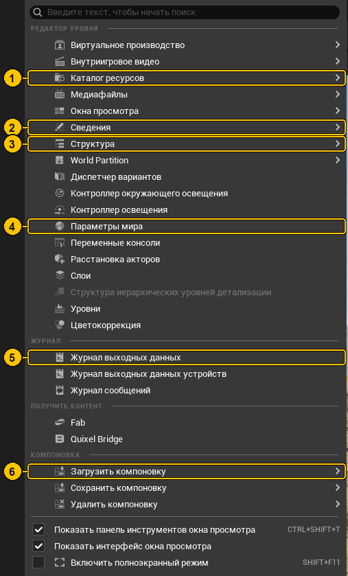

| № | Пункт | Что это и когда нужно |
|---|---|---|
| 1 | **Каталог ресурсов** | склад всех файлов проекта (Content Browser). Внутри — можно открыть до 4 штук |
| 2 | **Сведения** | настройки выделенного объекта (Details) |
| 3 | **Структура** | список объектов уровня (Outliner) |
| 4 | **Параметры мира** | настройки всего уровня: каким персонажем играть (GameMode Override), гравитация |
| 5 | **Журнал выходных данных** | лог: ошибки, предупреждения, вывод Python. Первое место, куда смотреть, [если что-то серое или сломалось](../06-faq.md#объект-или-трава-стали-серыми) |
| 6 | **Загрузить компоновку** | → **Default Editor Layout** — вернуть стандартную раскладку окон, если всё перепуталось |

Ещё полезное здесь: **Переменные консоли** (список всех консольных команд), **World Partition** (карта кусков большого мира), **Контроллер окружающего освещения** (собрать небо, солнце и туман одной кнопкой), **Fab** и **Quixel Bridge** (скачать бесплатные модели), внизу — **Включить полноэкранный режим** `Shift+F11`.

## Инструменты

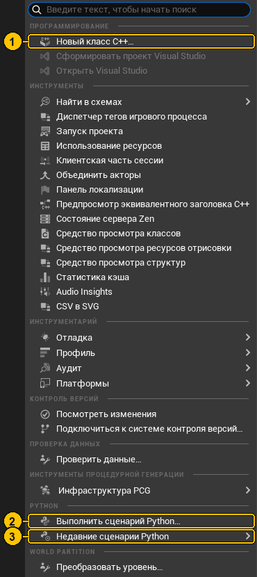

| № | Пункт | Что это и когда нужно |
|---|---|---|
| 1 | **Новый класс C++…** | начать писать код на C++. ⚠ Проект станет C++-проектом и потребует Visual Studio — не нажимай «просто посмотреть» |
| 2 | **Выполнить сценарий Python…** | запустить `.py`-файл ([глава 9](../proekt/09-python-i-avtomatizaciya.md)) |
| 3 | **Недавние сценарии Python** | быстро перезапустить тот же скрипт ещё раз |

Для любопытных: **Найти в схемах** — поиск по всем блюпринтам; **Использование ресурсов** — кто использует этот файл; **Объединить акторы** — слить несколько моделей в одну; **Инфраструктура PCG** — процедурная генерация.

## Сборка

«Сборка» — это когда Unreal заранее **просчитывает** что-то тяжёлое, чтобы не делать это во время игры.

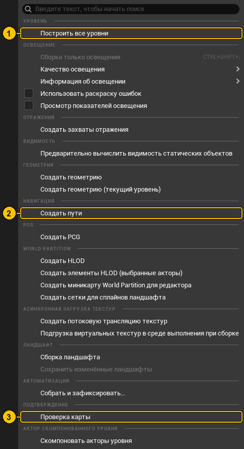

| № | Пункт | Что это и когда нужно |
|---|---|---|
| 1 | **Построить все уровни** | просчитать всё сразу. Долго. Тебе почти не нужно |
| 2 | **Создать пути** | навигация для ИИ (NavMesh): по каким местам могут ходить враги и NPC. Понадобится, когда появятся враги |
| 3 | **Проверка карты** | найти ошибки уровня: битые ссылки, пропавшие файлы |

> 📖 **Почему «Сборка освещения» серая и не нужна.** У тебя свет **динамический** (Lumen) — он считается сам каждый кадр. Запекать освещение нужно только для старого, статического света.

## Платформы

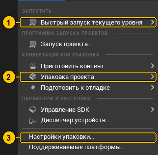

| № | Пункт | Что это и когда нужно |
|---|---|---|
| 1 | **Быстрый запуск текущего уровня** | запустить уровень как отдельную игру |
| 2 | **Упаковка проекта** → Windows | **собрать игру в `.exe`**, которую можно отдать другу ([финальный этап курса](../igry/09-final-sborka.md)) |
| 3 | **Настройки упаковки…** | что включать в сборку, какой уровень открывать первым |

## Выбор

Как выделить много объектов разом.

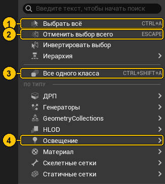

| № | Пункт | Клавиши | Что это |
|---|---|---|---|
| 1 | **Выбрать всё** | `Ctrl+A` | выделить всё на уровне |
| 2 | **Отменить выбор всего** | `Esc` | снять выделение |
| 3 | **Все одного класса** | `Ctrl+Shift+A` | выделил один куб — выделятся **все** такие же. Удобно менять материал у всех стен сразу |
| 4 | **По типу → Освещение** | | выделить все лампы и солнце. Рядом: Материал, Статичные сетки и др. |

## Актор

«Актор» — это любой объект на уровне. Меню действует на **выделенный** объект и совпадает с меню [правого клика по объекту](#правый-клик-по-объекту-во-вьюпорте). На скриншоте была выделена земля (`LandscapeStreamingProxy`), поэтому её имя видно в пунктах.

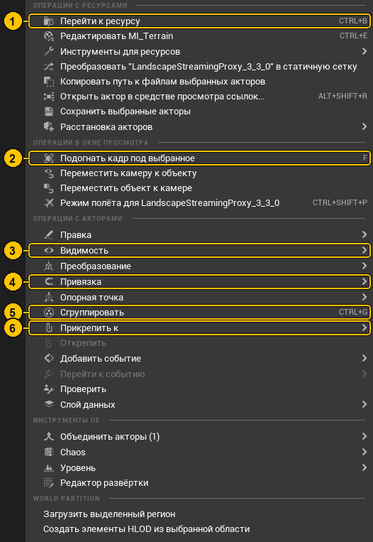

| № | Пункт | Клавиши | Что это |
|---|---|---|---|
| 1 | **Перейти к ресурсу** | `Ctrl+B` | показать в Каталоге файл, из которого сделан объект |
| 2 | **Подогнать кадр под выбранное** | `F` | подлететь камерой к объекту |
| 3 | **Видимость** | | спрятать объект или показать все спрятанные |
| 4 | **Привязка** | | прижать к полу (`End`), выровнять по сетке |
| 5 | **Сгруппировать** | `Ctrl+G` | склеить несколько объектов, чтобы двигать вместе |
| 6 | **Прикрепить к** | | сделать объект «ребёнком» другого |

## Справка

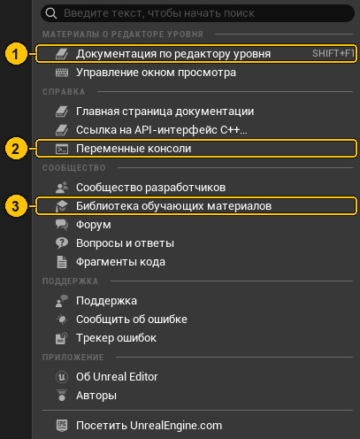

| № | Пункт | Что это |
|---|---|---|
| 1 | **Документация по редактору уровня** `Shift+F1` | официальная документация Epic (в браузере, на английском) |
| 2 | **Переменные консоли** | список всех консольных команд с описанием |
| 3 | **Библиотека обучающих материалов** | официальные уроки Epic: бесплатно, с видео |

## Кнопка кубик с плюсом (быстрое добавление)

Кнопка ⑥ на верхней панели. **Через неё ставят объекты на уровень.**


| № | Пункт | Что внутри |
|---|---|---|
| 1 | **Импорт контента…** | принести файлы с компьютера (то же, что «Импорт» в Каталоге) |
| 2 | **Базовые** | пустой Актор, Персонаж, **Игрок стартует** (PlayerStart), триггеры |
| 3 | **Освещение** | лампочка (точечный свет), прожектор, солнце (направленный свет) |
| 4 | **Фигуры** | **куб, сфера, цилиндр, плоскость** — черновые кирпичики. С них начинается [стройка дома](../igry/01-plan-i-chernovik.md) |
| 5 | **Области** | невидимые «зоны»: блокирующая стена, триггер «игрок вошёл», зона пост-обработки |

**Как поставить куб:** ⑥ → **Фигуры** → **Куб**. Он появится перед камерой.

## Кнопка Blueprint (рядом с кубиком)

Кнопка ⑦ на верхней панели.

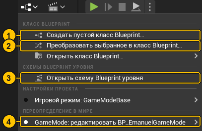

| № | Пункт | Что это |
|---|---|---|
| 1 | **Создать пустой класс Blueprint…** | новый блюпринт — объект со своей логикой (дверь, которая открывается) |
| 2 | **Преобразовать выбранное в класс Blueprint…** | выделил стены, пол и крышу → сделал из них один многоразовый «Дом» |
| 3 | **Открыть схему Blueprint уровня** | логика конкретного уровня (Level Blueprint) |
| 4 | **GameMode: редактировать BP_EmanuelGameMode** | игровой режим **этого уровня** — он решает, что за Emanuel ты играешь |

> 📖 **Почему там написано «Игровой режим: GameModeBase».** Это режим «по умолчанию для всего проекта». Уровень `num1` его переопределяет своим `BP_EmanuelGameMode` (пункт 4), поэтому играешь всё равно за Emanuel.

## Правый клик по объекту во вьюпорте

Кликни **правой кнопкой мыши по объекту в мире** — появится это меню. На скриншоте клик был по куску земли, поэтому в пунктах видно `MI_Terrain` и `LandscapeStreamingProxy`; у куба там будет его имя.

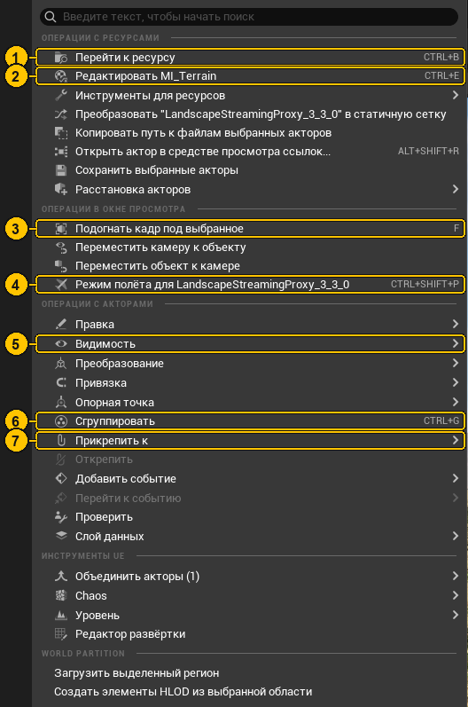

| № | Пункт | Клавиши | Что это |
|---|---|---|---|
| 1 | **Перейти к ресурсу** | `Ctrl+B` | показать в Каталоге, из какого файла сделан объект |
| 2 | **Редактировать MI_Terrain** | `Ctrl+E` | открыть материал объекта |
| 3 | **Подогнать кадр под выбранное** | `F` | подлететь камерой к объекту |
| 4 | **Режим полёта для …** | `Ctrl+Shift+P` | «вселиться» в объект: камера становится им. Удобно наводить лампы и камеры |
| 5 | **Видимость** | | спрятать объект или показать спрятанные |
| 6 | **Сгруппировать** | `Ctrl+G` | склеить несколько объектов, чтобы двигать вместе |
| 7 | **Прикрепить к** | | сделать объект «ребёнком» другого: двигаешь родителя — едет и ребёнок |

## Кнопка С освещением (режим просмотра)

Над миром справа. Меняет **как нарисована картинка** — для проверки и поиска проблем. На игру не влияет.

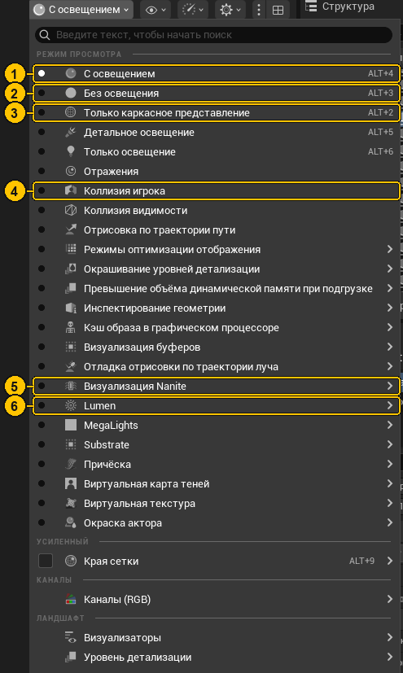

| № | Режим | Клавиши | Когда включать |
|---|---|---|---|
| 1 | **С освещением** | `Alt+4` | **обычный режим.** Если что-то стало странным — возвращайся сюда |
| 2 | **Без освещения** | `Alt+3` | только цвета, без света и теней — проверить текстуры в темноте |
| 3 | **Только каркасное представление** | `Alt+2` | сетка из линий — видно, из чего состоят модели |
| 4 | **Коллизия игрока** | | где персонаж упрётся в стену, а где пройдёт насквозь |
| 5 | **Визуализация Nanite** | | проверить технологию Nanite у моделей ([глава 4](../proekt/04-trava-i-kamni.md)) |
| 6 | **Lumen** | | как считается свет ([глава 6](../proekt/06-svet-i-teni.md)) |

## Кнопка глаз (Показать)

Над миром справа, рядом. Галочки — **что рисовать в редакторе**. Тоже не влияет на игру.

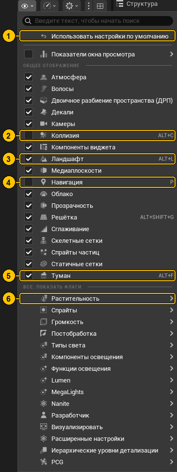

| № | Пункт | Клавиши | Зачем |
|---|---|---|---|
| 1 | **Использовать настройки по умолчанию** | | всё вернуть как было — если что-то пропало с экрана |
| 2 | **Коллизия** | `Alt+C` | показать невидимые стенки столкновений |
| 3 | **Ландшафт** | `Alt+L` | спрятать/показать землю |
| 4 | **Навигация** | `P` | зелёная зона, где может ходить ИИ (после «Сборка → Создать пути») |
| 5 | **Туман** | `Alt+F` | убрать туман, чтобы лучше видеть даль |
| 6 | **Растительность** | | спрятать траву, если тормозит или мешает строить |

> ⚠ **Пропала трава или земля?** Скорее всего, случайно нажал `Alt+L` или снял галочку. Пункт ① «Использовать настройки по умолчанию» вернёт всё.

## Кнопка шестерёнка (настройки вьюпорта)

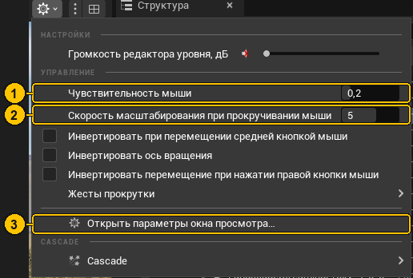

| № | Пункт | Что это |
|---|---|---|
| 1 | **Чувствительность мыши** | как быстро крутится камера. Дёргается — уменьши |
| 2 | **Скорость масштабирования при прокручивании мыши** | как сильно приближает колесо |
| 3 | **Открыть параметры окна просмотра…** | все остальные настройки |

## Проверь себя

```quiz
В: Где запустить Python-файл?
+ Инструменты → Выполнить сценарий Python…
- Окно → Журнал выходных данных
- Сборка → Построить все уровни
= Там же — «Недавние сценарии Python».

В: Где взять куб для черновой стены?
+ Кнопка «кубик с плюсом» → Фигуры → Куб
- Окно → Каталог ресурсов → Добавить
- Сборка → Создать геометрию
= Кубик с плюсом ставит объекты на уровень.

В: Пропала трава в редакторе. Что проверить первым?
+ Кнопка «глаз» → Использовать настройки по умолчанию
- Удалить и снова импортировать траву
- Сборка → Построить все уровни
= Скорее всего, случайно снята галочка «Растительность» или «Ландшафт».

В: Где задать, кем играет игрок на этом уровне?
+ Окно → Параметры мира → GameMode Override
- Справка → Документация
- Платформы → Упаковка проекта
= Или кнопка Blueprint → «GameMode: редактировать …».

В: Как собрать игру в .exe?
+ Платформы → Упаковка проекта → Windows
- Файл → Сохранить всё
- Сборка → Создать пути
= Упаковка готовит контент и собирает исполняемый файл.
```

---

← [Производительность](06-proizvoditelnost.md) · [Начни отсюда](../00-НАЧНИ-ОТСЮДА.md)
