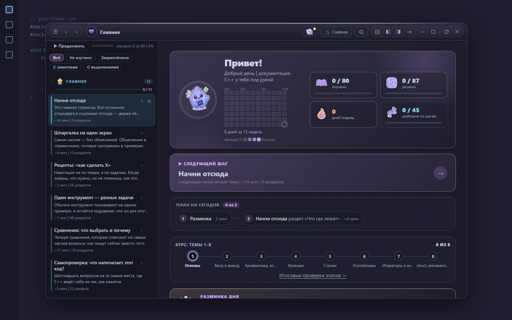
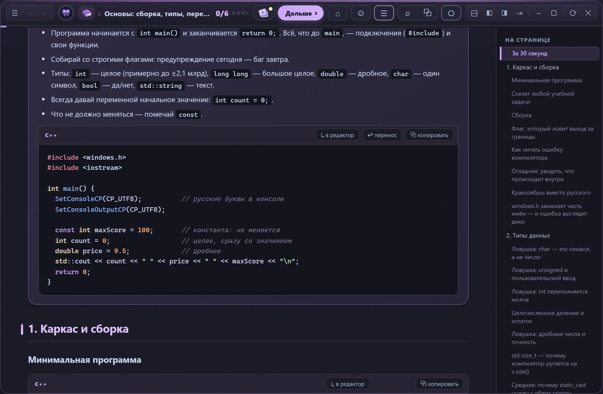
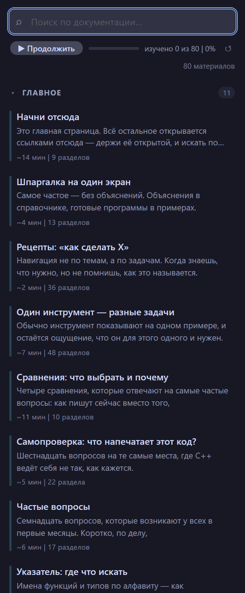

# Документация C++

**Справочник, примеры и задачник по C++ — прямо в VS Code, на русском.**

Теория по темам, девять разобранных программ и задачник на 77 задач с подсказками —
в удобном навигаторе с поиском, подсветкой синтаксиса и отметками «изучено».
Документация **встроена в расширение** — работает сразу после установки, без настройки.

---

## Что это

Расширение показывает материалы по C++ в двух видах:

- **Боковая панель** (в панели действий слева) — список всех материалов с группами,
  поиском по всему тексту, временем чтения и прогрессом «изучено N из M».
- **Плавающее окно** поверх редактора — перетаскивается за заголовок, тянется за края,
  запоминает позицию: слева навигатор, справа текст с подсветкой C++, кнопками
  «копировать код», таблицами, оглавлением и переходами по внутренним ссылкам.

Всё офлайн, без сети. Тема (светлая/тёмная) берётся из VS Code.

<table>
<tr>
<td align="center" width="66%"> <b>Плавающее окно</b> / читалка поверх кода</td>
<td align="center" width="34%"> <b>Боковая панель</b> / всегда под рукой</td>
</tr>
</table>

## Что внутри

- **Справочник по темам** — типы, ввод/вывод, циклы, функции, строки, контейнеры,
  алгоритмы, `struct` и файлы, плюс продвинутый ярус (классы, исключения, `string_view`,
  ranges, шаблоны, умные указатели, наследование).
- **Примеры программ** — девять законченных программ с разбором (калькулятор,
  список дел, крестики-нолики, телефонная книга и др.).
- **Задачник** — 10 тем, 77 задач от простых до сложных. Сначала решаете сами, застряли —
  раскрываете подсказку-спойлер (в темах 4–8 — лесенка из трёх ступеней: идея → план → ключевая строка),
  а решения с разбором собраны внизу страницы темы — отдельно, чтобы не подглядеть случайно.
- **Библиотека Unreal Engine** (по желанию) — укажите папку в `cppDocs.unrealPath`, и в шапке
  окна появится переключатель **C++ ⇄ UE**: у каждой библиотеки свой прогресс и свои закладки.

## Возможности

- 🔎 **Поиск по всему тексту** материалов — по названию, описанию и содержимому,
  без учёта регистра и без разницы «ё/е».
- 🟢 **Прогресс обучения** — отметки «изучено», полоса «N из M / %» и кнопка
  **▶ Продолжить** к следующему неизученному материалу.
- 🎨 **Подсветка C++ и bash**, кнопки «копировать код», таблицы, оглавление файла,
  сворачиваемые подсказки, переходы по ссылкам между материалами.
- ⚡ **Быстрые слова** — `main`, `readint`, `vec`, `sort`… вставляют готовый код и сами дописывают
  недостающие `#include` и вспомогательные функции ввода, не повторяя уже подключённое.
- 💡 **Подсказка по слову под курсором** — стоите на `vector` или `getline` в `.cpp`, а окно
  показывает справку по нему; подсказки по правилам курса (`using namespace std`, `rand()` и др.).
- ⌨️ **Клавиатура:** `↑`/`↓` — выбор, `Enter` — открыть, `/` или `Ctrl+K` — в поиск,
  `Ctrl+Alt+D` — фокус в поиск, `Ctrl+Alt+M` — открыть меню отдельной панелью.

## Быстрый старт

1. Установите расширение.
2. Откройте панель **«Документация C++»** — иконка книги в панели действий слева.
   Материалы появятся сразу (документация встроена в расширение).
3. Хотите **плавающее окно** поверх кода — см. раздел «Плавающее окно» ниже.

## Плавающее окно (опционально)

Окно документации открывается двумя способами:

- **Во вкладке** — команда **«Документация C++: открыть окно во вкладке (без правки VS Code)»**. Обычная
  вкладка редактора: ничего не меняет в самом VS Code, работает везде.
- **Плавающее окно поверх кода** — команда **«Документация C++: подключить плавающее окно»**
  (`Ctrl+Shift+P`) или кнопка `▣` в шапке панели. Расширение само впечатывает окно в оболочку VS Code
  (сторонние загрузчики не нужны), после перезапуска справа внизу появится пилюля **«C++»**. Окно можно
  двигать, сворачивать в полоску и **закрепить справа** (кнопка `⇥`) — тогда редактор сдвигается и не
  прячется под окном.

> 💜 Если установлен **[Moon Core](https://marketplace.visualstudio.com/items?itemName=moonlivedt.moon-core)**,
> окно встраивает он: без своей правки оболочки и без баннера «установка повреждена».
>
> ⚠️ Без Moon Core правка оболочки показывает баннер «installation appears to be corrupt» — это ожидаемо,
> его можно закрыть. После обновления VS Code расширение предложит восстановить окно. При удалении расширения
> вставка снимается сама (хук удаления); вручную — «Документация C++: отключить плавающее окно».
> **Боковая панель и вкладка работают без всякой правки** — плавающее окно опционально.

## Настройки

| Настройка | Назначение |
|---|---|
| `cppDocs.path` | Папка со своей документацией. Пусто — используется встроенная. |
| `cppDocs.openInPreview` | Открывать материалы в режиме чтения (превью Markdown). |
| `cppDocs.unrealPath` | Папка с документацией Unreal Engine — включает переключатель C++ ⇄ UE. |
| `cppDocs.smartSnippets` | Быстрые слова C++ с умной вставкой `#include` и функций ввода. |
| `cppDocs.editorBridge` | Подсказка в окне по слову под курсором в C/C++-файле. |
| `cppDocs.styleHints` | Подсказки по правилам курса в открытом `.cpp`. |
| `cppDocs.localRun` / `cppDocs.compiler` | Кнопка «Запустить» в задачах: компиляция вашим локальным компилятором. |

---

## In English

**C++ Docs** is a Russian-language C++ reference, worked examples and a problem book
(77 exercises with step-by-step hints) right inside VS Code: a sidebar with full-text search and
“studied” progress, plus a floating reader window over your code with C++ highlighting, copy
buttons and a table of contents. Smart snippets add missing `#include`s for you, and an optional
Unreal Engine library sits behind a C++ ⇄ UE switch. Works fully offline, zero dependencies.
An English README is in the [repository](https://github.com/moonlivedt-oss/cpp-panel-Moon/blob/main/README.en.md).

---

## Ссылки

- Исходный код и подробный README: [репозиторий на GitHub](https://github.com/moonlivedt-oss/cpp-panel-Moon)
- Ошибки и предложения: [Issues](https://github.com/moonlivedt-oss/cpp-panel-Moon/issues)
- История изменений: [CHANGELOG](https://github.com/moonlivedt-oss/cpp-panel-Moon/blob/main/CHANGELOG.md)

Лицензия: MIT.
